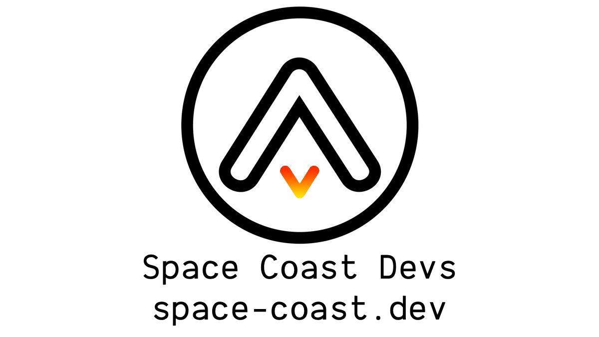

# Space Coast Devs

## About Us

Space Coast Devs (formerly Space Coast Tech Club) is a place for developers, designers, scientists, IT professionals, and technologists to learn and share knowledge about technology. We host meetups and other events to facilitate community members to connect with one another. We also have a Discord server where the community can chat and ask questions. We welcome people of all skill levels and backgrounds.

If you are in the Space Coast area, we would love to have you join us!

## Meetups

https://space-coast.dev/meetups

## Discord

https://space-coast.dev/discord

## Event imports

The weekly refresh runs `pnpm run filter:events` after importing both months and before opening the refresh PR. When an organizer confirms a cancellation and the listing should be removed, delete only the matching generated record and, for Meetup, add its exact occurrence ID to `scripts/filter-events.ts` so the next import cannot restore it. Do not exclude an entire recurring series. Run the regression with `node --import tsx --test tests/event-filter.test.ts`.
